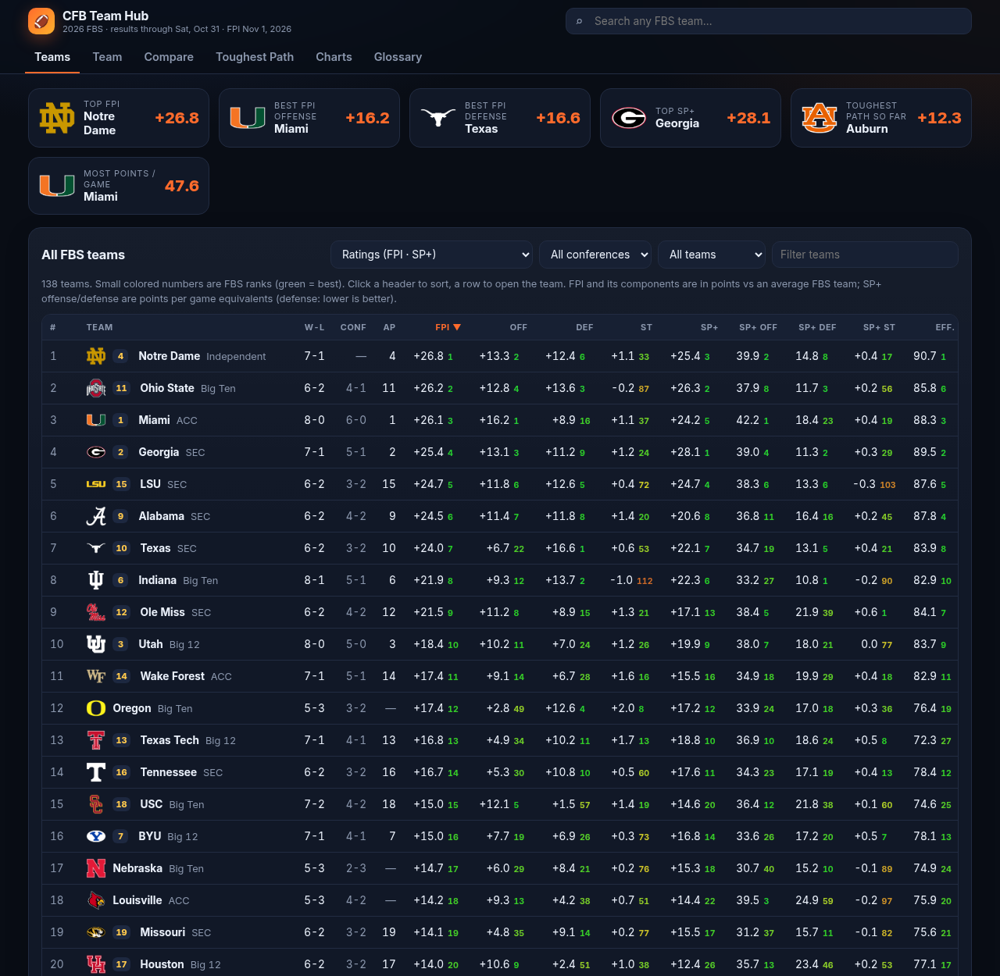
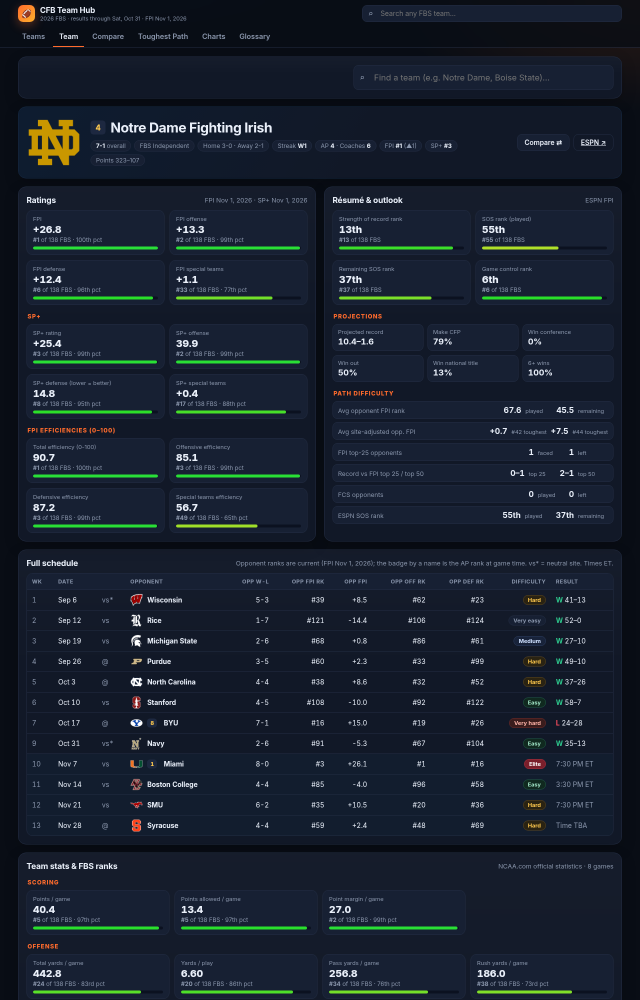

# CFB Team Hub — 2026 FBS

A team-based college football dashboard for all **138 FBS teams**: ESPN FPI (with offense / defense / special-teams components), SP+, AP & Coaches polls, records, 30+ rankable team stats, and full schedules with an opponent-strength ("path difficulty") breakdown.

**Live:** https://coleslaw510.github.io/cfb-team-hub/




## What's in it
| Tab | What it shows |
|---|---|
| **Teams** | Sortable, filterable table of every FBS team (by conference; AP-ranked / unranked / FPI top 25). Views: Ratings (FPI + off/def/ST, SP+ + components, efficiencies), Résumé (SOR, SOS, remaining SOS, game control, projections), Offense, Defense, Misc. Every value shows its FBS rank. |
| **Team** (`#team=ohio-state`) | Header (logo, record, polls, ranks), FPI/SP+/efficiency tiles with FBS rank & percentile, ESPN résumé & projections, path-difficulty summary, **full schedule** (date, site, opponent logo/record/FPI rank/offense & defense rank, result or kickoff, difficulty pill), and a stat grid with ranks & percentiles. |
| **Compare** (`#compare=miami,notre-dame`) | 2–4 teams side by side: percentile radar, head-to-head tally, every metric with the leader highlighted. Shareable link. |
| **Toughest Path** (`#path`) | League-wide ranking of schedule difficulty so far, next to ESPN's own SOS rank and remaining-schedule difficulty. |
| **Charts** | FPI offense vs defense logo scatter (also SP+ or yards/play), and a leaders bar chart for any metric. |
| **Glossary** | FPI, SP+, SOR, SOS, game control, efficiencies, path method, every stat. |

## Data sources
- **ESPN FPI** — `sports.core.api.espn.com/v2/sports/football/leagues/college-football/seasons/2026/powerindex` (FPI, offense/defense/ST components, SOR, SOS, remaining SOS, game control, projections, efficiencies).
- **ESPN** standings, team schedules (regular + postseason) and rankings (AP Top 25, AFCA Coaches Poll) via `site.api.espn.com`.
- **NCAA.com official FBS team statistics** (`ncaa.com/stats/football/fbs/current/team/{id}`) — scoring, yardage, yards/play, pass/rush splits, turnover margin, 3rd/4th down, red zone, sacks, TFL, penalties, time of possession, net punting. (ESPN's team-stats API has no defensive/opponent or red-zone splits.)
- **SP+** — Bill Connelly's weekly ESPN article ("2026 college football SP+ rankings: all 138 FBS teams"), parsed for overall, offense, defense and special teams with ranks. (The CFBD API needs a key, so the article is the source.)
- **CFP rankings** — not yet released for 2026 at build time; the app shows them automatically once ESPN's rankings feed includes them.

Logos and colors come from ESPN's team API/CDN. Not affiliated with ESPN, the NCAA or CFBD.

## Path-difficulty method
Each game's opponent strength = opponent's **current** FPI, site-adjusted by a 2.5-point home-field rule of thumb (+2.5 on the road, −2.5 at home, 0 neutral). That adjusted value is mapped to the equivalent FBS FPI rank to grade the game: Elite (1–10), Very hard (11–25), Hard (26–50), Medium (51–85), Easy (86–115), Very easy (116+). FCS opponents count as the lowest-rated FBS team (and rank N+1 in rank averages). The "toughest path so far" ranking sorts by average adjusted opponent FPI in games already played. ESPN's SOS (which measures how an average top-25 team would fare) is shown alongside for reference.

## Refresh
```bash
python3 -m venv .venv && .venv/bin/pip install pandas beautifulsoup4 lxml
.venv/bin/python update_data.py --season 2026        # downloads (cached in raw/), writes data/teams.json
.venv/bin/python update_data.py --season 2026 --offline   # rebuild from cache only
```
Update the SP+ article URL (`SP_URL` in `update_data.py`) when a new weekly edition is published. Then commit `data/teams.json`. Static site — serve locally with `python3 -m http.server`.

## Caveats
- Ratings and polls are a snapshot (see footer for data-through date); FPI-based schedule grades move as FPI updates.
- NCAA.com team stats include games vs FCS opponents.
- Home-field 2.5 pts is a generic rule of thumb, not ESPN's exact adjustment.
